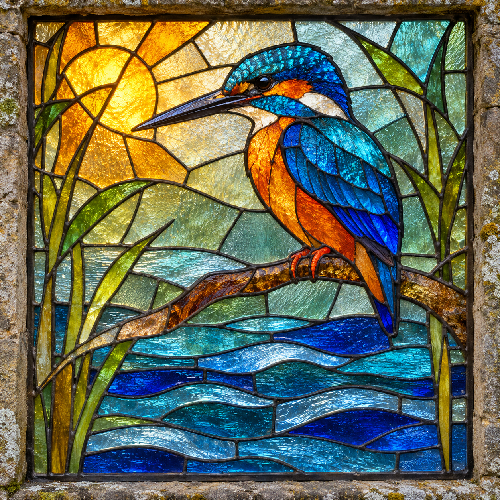
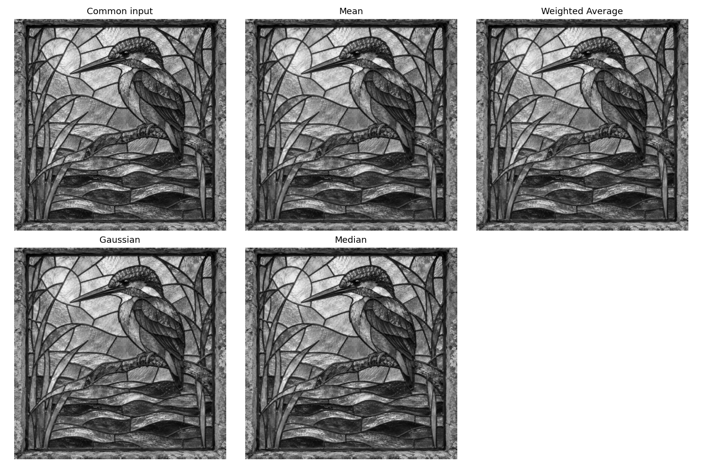
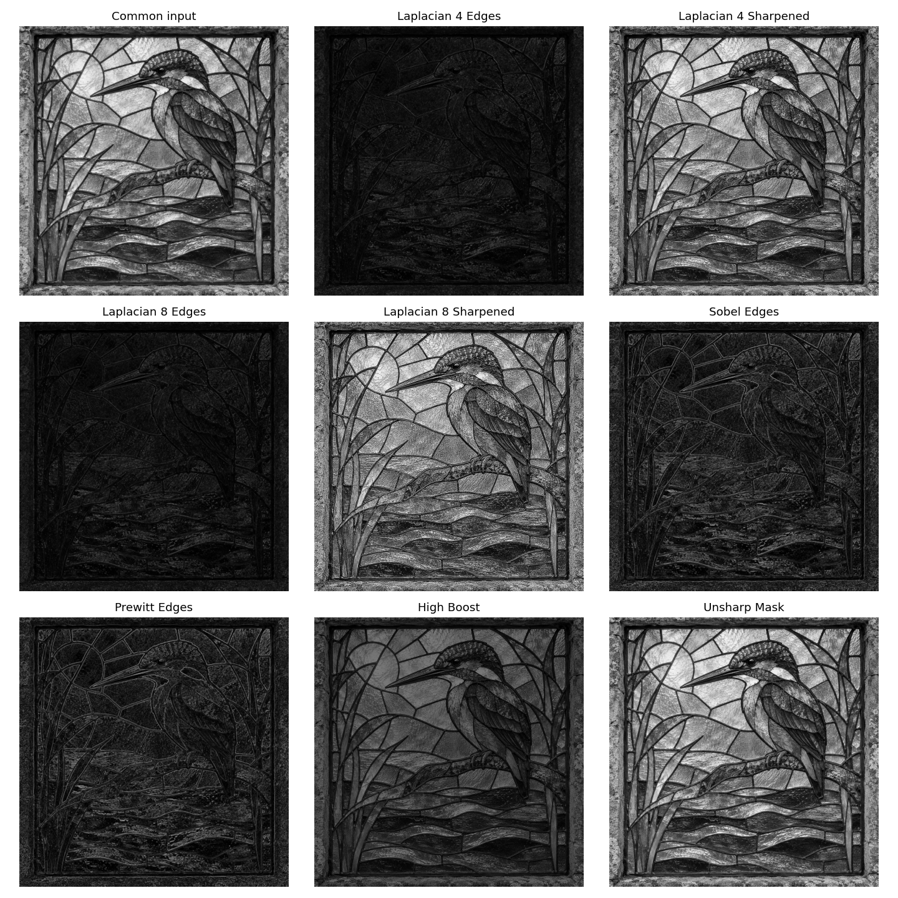

# Image Filters

Apply spatial filters to one image and save the results.

**Smoothing:** Mean, Weighted Average, Gaussian, Median.

**Sharpening and edges:** Laplacian (4 and 8 neighbors), Sobel, Prewitt, High-Boost, Unsharp Mask.

## Run

From the repository root:

```bash
python -m pip install -r requirements.txt
python image_filters/apply_filters.py
```

Use your own image:

```bash
python image_filters/apply_filters.py --input path/to/image.jpg --output results
```

Images are converted to grayscale. Results and comparison sheets are saved in
`output/`. Optional settings: `--ksize 5`, `--sigma 1.5`, `--A 2`,
or `--noise salt_pepper`.

High-Boost uses `A * image - blurred_image`; use `A=2` to preserve flat-region brightness.

## Sample image

Original AI-generated stained-glass kingfisher image, created for this project with
the built-in image generation tool. Dark lead outlines demonstrate edge detection;
fine glass texture and light gradients demonstrate smoothing and sharpening.
All outputs use the same grayscale conversion for direct comparison.
See [generation details](../assets/README.md).






